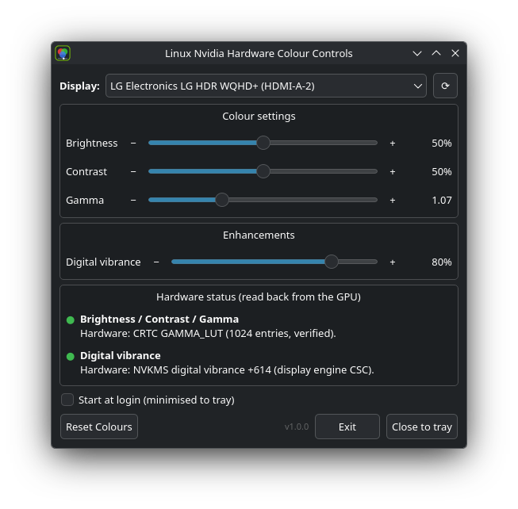

# Linux Nvidia Hardware Colour Controls

NVIDIA Control Panel–style **Brightness, Contrast, Gamma and Digital Vibrance**
for Linux (KDE Plasma 6, Wayland), applied **only in the GPU's display hardware**.
The app has no software, shader or per-application colour correction. Settings are saved per display and re-applied at login.



Tested on CachyOS, KDE Plasma 6.8.3 (Wayland), NVIDIA open kernel modules 620.73.04, GeForce RTX 5070.

## Install

### Install from a package (Fedora, Debian, CachyOS)

Download the package for your distribution from the
[Releases page](https://github.com/AtmanActive/Linux-Nvidia-Hardware-Colour-Controls/releases)
and install it with your package manager, which should also install the dependencies:

| Distribution | Install |
|---|---|
| **CachyOS** (also Arch Linux) | `sudo pacman -U linuxnvidiahwcc-<version>-x86_64.pkg.tar.zst` |
| **Fedora** | `sudo dnf install ./linuxnvidiahwcc-<version>.x86_64.rpm` |
| **Debian** 13 or newer | `sudo apt install ./linuxnvidiahwcc_<version>_amd64.deb` |

Then start **Linux Nvidia Hardware Colour Controls** from the application menu and tick
*Start at login*. Before removing the package, click **Reset Colours** (or run
`linuxnvidiahwcc --reset`) to make KDE release the app's colour profile.

Or install from source, for your user only:

### Install from source

### 1. Install the requirements

```sh
sudo pacman -S --needed git pyside6 base-devel
```

`git` is only needed if you clone (option A below). See [Requirements](#requirements) for details.

### 2. Get the code

**Option A: clone with git** (recommended, since updating is just one command)

```sh
git clone https://github.com/AtmanActive/Linux-Nvidia-Hardware-Colour-Controls.git
cd Linux-Nvidia-Hardware-Colour-Controls
```

**Option B: download without git**

```sh
curl -L -o Linux-Nvidia-Hardware-Colour-Controls.zip \
  https://github.com/AtmanActive/Linux-Nvidia-Hardware-Colour-Controls/archive/refs/heads/main.zip
unzip Linux-Nvidia-Hardware-Colour-Controls.zip
cd Linux-Nvidia-Hardware-Colour-Controls-main
```

Or, in a web browser, open the [repository page](https://github.com/AtmanActive/Linux-Nvidia-Hardware-Colour-Controls),
click **Code → Download ZIP**, extract it, and open a terminal in the extracted
`Linux-Nvidia-Hardware-Colour-Controls-main` folder.

### 3. Run the installer

```sh
./install.sh                         # installs to ~/.local, enables start at login
~/.local/bin/linuxnvidiahwcc --show  # or start "Linux Nvidia Hardware Colour Controls" from the menu
```

No root is needed. The installer builds the small vibrance helper, installs the app for
your user only, adds a menu entry, and enables start at login (`./install.sh --no-autostart`
skips that). If you get *Permission denied*, your archive tool dropped the executable flag:
run `bash install.sh` instead.

Keep the downloaded folder: it holds the uninstaller and the driver-update script.

### Update

```sh
git pull && ./install.sh   # option A; with option B, download again and re-run ./install.sh
```

### Uninstall

`./uninstall.sh` resets the displays to neutral and removes the program
(`--purge` also removes settings).

## Requirements

* KDE Plasma 6 on Wayland (`kscreen-doctor`). Tested on Plasma 6.8. Older KWin without
  `MHC2` support (such as Plasma 6.3 in Debian 13) uses the profile's `vcgt` table instead;
  that path is checked with LittleCMS but not yet on real hardware.
* NVIDIA driver with `nvidia_drm.modeset=1` (default on current drivers).
* `pyside6`, `python`, and `base-devel` (to build the helper):
  `sudo pacman -S --needed pyside6 base-devel`

## Usage

* Starting the app puts it in the **tray** only. Click the tray icon, or launch it from the menu, to open the window. Closing the window hides it again.
* **Resource use in the tray: none.** While hidden in the tray, or minimised, the app has no timers and no polling. It only reacts to actions restoring, *Re-apply settings*, or *Exit*/*Quit*. Opening the window resumes the 3 s watchdog and catches up on anything missed.
* Use *Exit* in the window or *Quit* in the tray menu to exit. Brightness/Contrast/Gamma stay applied, since KWin keeps the profile. Vibrance stays until the next suspend or reboot.
* CLI: `linuxnvidiahwcc --apply` re-applies the saved settings once, `--reset` resets every display to neutral, and `--status` shows each adjustment applied.

## Limitations

* **No Hue**: there is no hardware path for it on Linux with NVIDIA.
* **HDR mode**: KWin's HDR pipeline doesn't use these settings, so Brightness/Contrast/Gamma are not applied while HDR is on. Digital Vibrance still works.
* **Night Light** works together with these settings. KWin combines both into the same hardware LUT, and the status panel reports it.
* Per-channel (R/G/B) adjustment is not exposed yet, although the profile format supports it.
* Single NVIDIA GPU (GPU 0; set `NVIDIA_GPU=n` to pick another).

## What is possible on Linux (research summary)

On Windows, the NVIDIA Control Panel writes Brightness/Contrast/Gamma into the display engine's gamma ramp (a hardware LUT) and Digital Vibrance/Hue into the display head's colour-space converter. Linux has the same hardware, but on Wayland the compositor (KWin) owns the display, so the question is which of those hardware registers a normal user program can still reach.

| Control | Hardware path on Linux / Wayland | Status in this app |
|---|---|---|
| **Digital Vibrance** | NVKMS ioctl `SET_DPY_ATTRIBUTE(DIGITAL_VIBRANCE)` on `/dev/nvidia-modeset`. Needs no display ownership. The driver programs it as a saturation matrix in the head's output CSC (`nvkms-evo3.c`). | ✅ hardware |
| **Brightness / Contrast / Gamma** | The CRTC `GAMMA_LUT` (1024 entries on the RTX 5070). Only KWin (DRM master) can write it, and NVKMS `SET_LUT` needs ownership too. KWin 6.8 **does** put an ICC profile's `MHC2`/`vcgt` LUT into the CRTC `GAMMA_LUT` when the colour power preference is *prefer efficiency*. | ✅ hardware, via KWin |
| **Hue** | Needs a colour matrix. NVKMS exposes no hue attribute, and KWin deliberately leaves the CRTC `CTM` out of its pipeline on NVIDIA (`drm_crtc.cpp`: on NVIDIA the CTM is a per-plane, pre-blend matrix). Any matrix therefore makes KWin fall back to a full-screen **shader**. | ❌ no hardware path, **not included** |

These findings were checked on real hardware by reading the CRTC properties back with DRM ioctls. With a Gamma 1.5 profile, `GAMMA_LUT[256]` held 0.397, exactly 0.25^(1/1.5) from NVIDIA's ramp formula. With a Hue profile, KWin removed the LUT and composited in a shader instead, which is why Hue is not part of this app. KDE's Night Light, by contrast, is folded by KWin into the same hardware LUT.

## How it works

* **Brightness/Contrast/Gamma**: Utilizing NVIDIA's own ramp formula (from `nvidia-settings`, `ComputeGammaRampVal`), using the Control Panel's ranges (0–100 %, 0–100 %, 0.30–2.80). It is written into an ICC v4 profile twice: as the LUT of the `MHC2` tag (used by current KWin) and as a `vcgt` table (used by older KWin without MHC2 support, such as Plasma 6.3). The profile's primaries are exactly sRGB/BT.709 with a D65 white, so KWin's compositing is not altered. The profile is applied with `kscreen-doctor`, and KWin programs the LUT into the CRTC `GAMMA_LUT`. KWin stores the profile in its own output config, so it is active from the moment you log in.
* **Digital Vibrance**: 0–100 % (50 % = neutral), mapped to the NVKMS range −1024…1023. The driver can forget it after suspend, DPMS or a modeset. While the window is open, the app checks every 3 s and re-applies it. While the app is in the tray it does nothing, so a lost vibrance is restored the next time you open the window or choose *Re-apply settings* from the tray menu.
* **Display mapping**: Utilizing KDE output → DRM connector → CRTC index, which equals the NVIDIA display head → NVKMS port. EDID matching is avoided on purpose: HDMI splitters, switches and KVMs can make DRM and NVKMS report different EDIDs.
* **Hardware only, enforced**: after every change the app reads the CRTC `GAMMA_LUT` and the NVKMS vibrance back from the GPU. If KWin did not put Brightness/Contrast/Gamma into the hardware LUT, the app **withdraws its profile** instead of letting KWin render it in a shader. It also always sets KDE's colour power preference to *prefer efficiency*, which is what allows the hardware offload in the first place.
* **Neutral = untouched**: when Brightness/Contrast/Gamma are all neutral, the app restores whatever colour profile KWin used before (sRGB, EDID or your own ICC).

## After NVIDIA driver updates

The helper is built against NVKMS headers vendored in `helper/nvidia-headers` (see `VERSION`). NVKMS checks the driver version at runtime, and the struct layouts rarely change. If vibrance stops working after a driver update, run:

```sh
helper/update-headers.sh && ./install.sh
```

## Making a release

Releases are built by the **Release** workflow (`.github/workflows/release.yml`), started
on demand from the repository's **Actions** tab: *Release* → *Run workflow*.

1. Set `__version__` in `linuxnvidiahwcc/__init__.py` and push.
2. Run the workflow. It builds the `.rpm` (Fedora), `.deb` (Debian) and `.pkg.tar.zst`
   (CachyOS/Arch) in clean `fedora:latest`, `debian:stable` and `archlinux:latest`
   containers, installs each package with its dependencies and smoke-tests it, then creates
   a **draft** release `v<version>` with the packages and `SHA256SUMS` attached.
3. Review the draft on the Releases page and publish it. Publishing creates the tag.

Running it again for the same version updates the draft. To re-package a version that is
already published, run it with *Package release* set to 2, 3, … (tagged `v<version>-2`, …).
The same build also runs locally, as root in a container of the target distribution:
`bash packaging/build-package.sh fedora` (or `debian`, `cachyos`).

## Credits

* NVKMS interface headers: NVIDIA open-gpu-kernel-modules (MIT, see `helper/nvidia-headers/COPYING`).
* Brightness/contrast/gamma formula: NVIDIA nvidia-settings.
* nvibrant by Tremeschin, for showing that NVKMS display attributes are reachable on Wayland.
